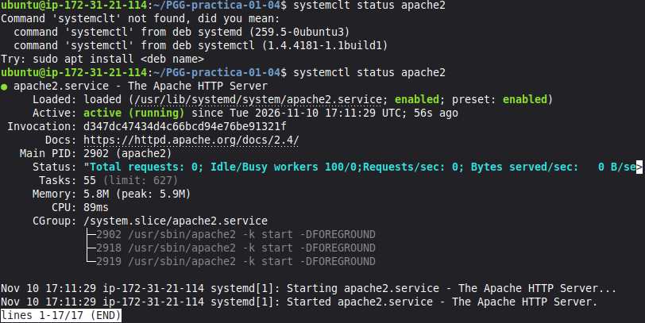
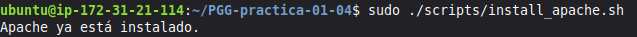
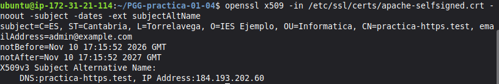
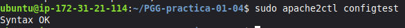
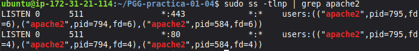
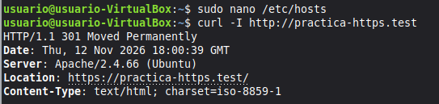
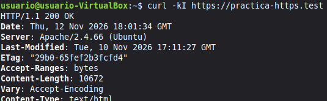
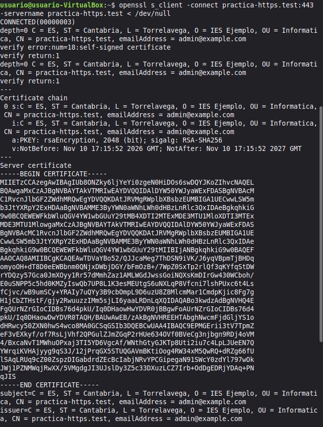
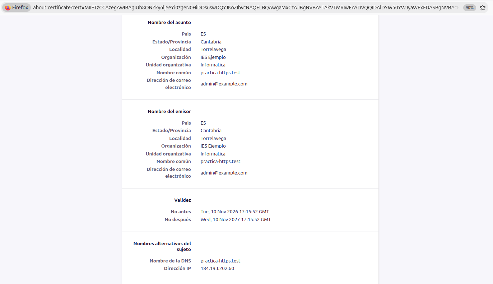
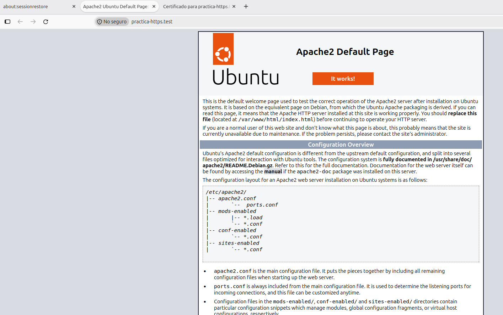

# Práctica 1.4 — HTTPS con certificado autofirmado en Apache

**Alumno:** Pablo González García

**Módulo:** Despliegue de Aplicaciones Web (DAW2)

---

## 1. Preparación del Entorno (Pasos previos manuales)
Antes de ejecutar los scripts, se han realizado las siguientes acciones manuales:
1. Creación de instancia EC2 (Ubuntu Server LTS, t2.micro).
2. Configuración del Security Group permitiendo tráfico SSH (22), HTTP (80) y HTTPS (443).
3. Asignación de una IP Elástica a la instancia.
4. Clonación de este repositorio en la instancia.
5. Configuración del archivo `/etc/hosts` en la máquina local (anfitrión) apuntando el dominio `practica-https.test` a la IP Elástica.

---

## 2. Explicación de los Scripts

### `install_apache.sh`
Este script automatiza la instalación y puesta en marcha del servidor web Apache en Ubuntu Server:
* Verifica mediante `dpkg` si el paquete `apache2` ya se encuentra instalado en el sistema para evitar ejecuciones redundantes (idempotencia).
* Si no está instalado, actualiza los repositorios (`apt update`) e instala Apache de forma desatendida (`-y`).
* Habilita el servicio para que arranque automáticamente con el sistema (`systemctl enable apache2`) y lo inicia (`systemctl start apache2`).

### `setup_selfsigned_certificate.sh`
Este script configura el entorno HTTPS mediante un certificado SSL/TLS autofirmado:
* Carga las variables de entorno definidas en `scripts/.env` (país, provincia, localidad, organización, dominio, IP elástica y rutas).
* Genera una clave privada RSA de 2048 bits y un certificado autofirmado X.509 válido por 365 días mediante `openssl`, incluyendo la extensión **SAN (Subject Alternative Name)** tanto para el dominio `practica-https.test` como para la IP Elástica.
* Copia los archivos de configuración de los Virtual Hosts HTTP y HTTPS a `/etc/apache2/sites-available/`.
* Activa los módulos `ssl` y `rewrite`, habilita los nuevos sitios virtuales y deshabilita el sitio por defecto (`000-default.conf`).
* Valida la sintaxis de configuración (`apache2ctl configtest`) y reinicia el servicio de Apache para aplicar los cambios.

---

## 3. Verificación y Evidencias

A continuación se muestran las pruebas de funcionamiento requeridas tras la ejecución de los scripts.

### Evidencia 1: Instalación de Apache
**Comando ejecutado:**
```bash
sudo ./scripts/install_apache.sh
systemctl status apache2
```
**Resultado:**



### Evidencia 2: Reejecución del script de instalación
**Comando ejecutado:**
```bash
sudo ./scripts/install_apache.sh
```
**Resultado:**



### Evidencia 3: Sujeto, validez y SAN del certificado
**Comando ejecutado:**
```bash
openssl x509 -in /etc/ssl/certs/apache-selfsigned.crt -noout -subject -dates -ext subjectAltName
```
**Resultado:**



### Evidencia 4: Sintaxis de Apache
**Comando ejecutado:**
```bash
sudo apache2ctl configtest
```
**Resultado:**



### Evidencia 5: Puertos a la escucha
**Comando ejecutado:**
```bash
sudo ss -tlnp | grep apache2
```
**Resultado:**



### Evidencia 6: Redirección HTTP → HTTPS (Desde equipo local)
**Comando ejecutado:**
```bash
curl -I http://practica-https.test
```
**Resultado:**



### Evidencia 7: Respuesta HTTPS (Desde equipo local)
**Comando ejecutado:**
```bash
curl -kI https://practica-https.test
```
**Resultado:**



### Evidencia 8: Negociación TLS
**Comando ejecutado:**
```bash
openssl s_client -connect practica-https.test:443 -servername practica-https.test < /dev/null
```
**Resultado:**



### Evidencia 9: Acceso desde el Navegador
Acceso a `https://practica-https.test` aceptando el riesgo de CA no confiable.

**Captura del sitio web y detalles del certificado:**





---

## 4. Incidencias Encontradas y Soluciones Aplicadas

Durante el desarrollo y despliegue de la práctica en AWS se presentaron los siguientes inconvenientes técnicos, que fueron resueltos de la siguiente manera:

1. **Error de permisos al ejecutar los scripts (`Permission denied`):**
   * **Problema:** Al intentar lanzar `sudo ./scripts/install_apache.sh` tras clonar el repositorio en la instancia EC2, el sistema devolvió `Permission denied (os error 13)` porque los archivos no conservaban el atributo de ejecución.
   * **Solución:** Se asignaron permisos de ejecución a todos los scripts mediante el comando `chmod +x scripts/*.sh`.

2. **Fallo de autenticación al hacer `git push` desde la instancia EC2:**
   * **Problema:** GitHub rechazó la subida de cambios mediante contraseña (`Password authentication is not supported for Git operations`) y posteriormente denegó el acceso por SSH (`Permission denied (publickey)`) al no estar vinculada la instancia.
   * **Solución:** Se generó un par de claves SSH (`ssh-keygen -t ed25519`) en la máquina EC2, se añadió la clave pública a la configuración de GitHub (*SSH and GPG keys*) y se actualizó la URL remota del repositorio con `git remote set-url origin`.

3. **Conflictos de sincronización en Git (`fetch first` / cambios locales):**
   * **Problema:** Al retomar la práctica y existir cambios previos tanto en la instancia remota como en el repositorio de GitHub, Git bloqueó el `git push` y el `git pull` para evitar sobrescrituras.
   * **Solución:** Se integraron los cambios remotos mediante `git pull origin main --no-rebase`, resolviendo la fusión antes de realizar el `git push` definitivo.

4. **Visualización de la extensión SAN en el navegador Firefox:**
   * **Problema:** Al inspeccionar el certificado autofirmado en Firefox, la extensión SAN no figuraba literalmente con esas siglas.
   * **Solución:** Se verificó dentro de la ventana *Información de la página > Seguridad > Ver certificado* en el apartado traducido **Nombres alternativos del sujeto**, comprobando que recogía tanto el `Nombre de la DNS` (`practica-https.test`) como la `Dirección IP` elástica asignada.
